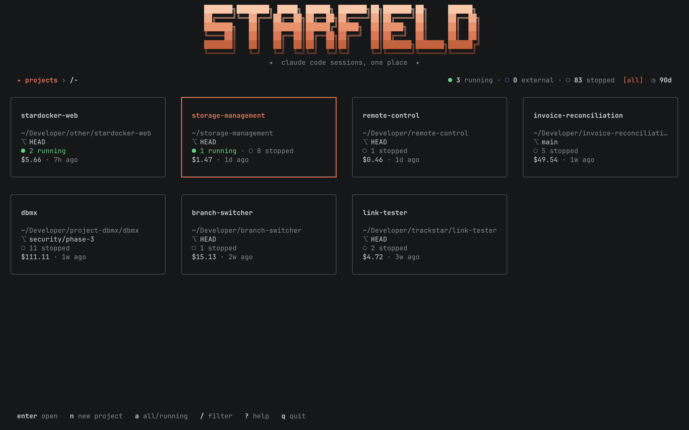
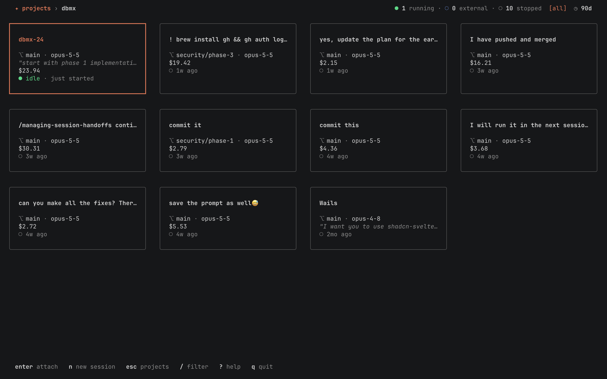
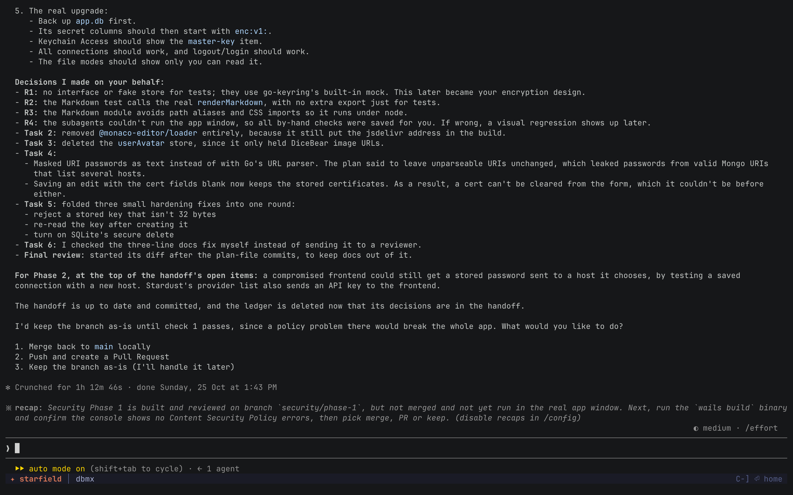
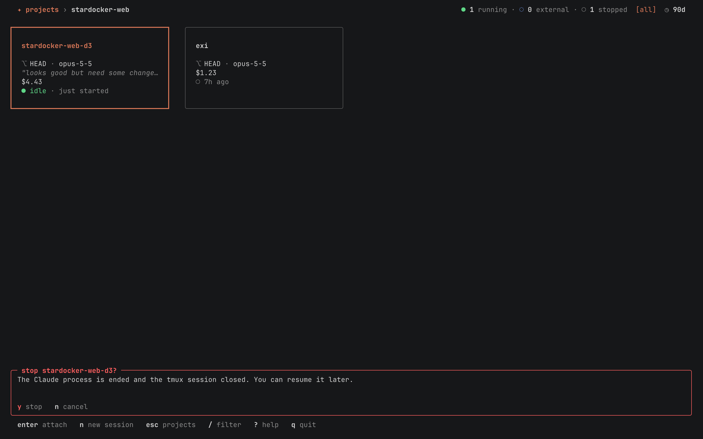

# starfield

**Every Claude Code session you have, in one terminal.**

Starfield is a terminal UI for Claude Code. It finds every session in every directory, whether it's running, running in some other terminal, or stopped, and shows them as cards grouped by project. Press enter to jump into one and the detach key to come back; the session keeps running underneath. No more juggling a terminal tab per project.



## Features

- **Projects at a glance.** The home screen shows one card per directory that has Claude sessions: path, git branch, how many sessions are running, external or stopped, total cost, and when it was last active. Projects with something running come first.
- **Every session, live or not.** Open a project to see its sessions as cards. Each card shows the title, branch and model, the last prompt, cost and message count, and a state line:
  - `● idle · up 2h`, or a pulsing `◐ working` while Claude is thinking
  - `◔ starting…` while a new session boots
  - `◌ external · pid 1234` for Claude running in another terminal
  - `○ 3h ago` for a stopped session
- **A real terminal inside.** Enter attaches your terminal to the session through tmux. Shift+enter, colours, mouse scroll and the clipboard work as they do in Ghostty, kitty, iTerm2 or WezTerm. `C-]` brings you back, and the session keeps running.
- **Resume anything.** Enter on a stopped session runs `claude --resume` in a fresh managed session and attaches, so a conversation from last month is one keypress away.
- **New sessions fast.**
  - `n` inside a project starts a new Claude session there at once.
  - `n` on the projects screen opens a fuzzy directory picker. It lists the folders you've used Claude in, most recent first, and the git repos under your roots.
  - In the picker, type a path (`/`, `~`, `.`) to use any directory. Type a plain name like `myproj` to create `~/Developer/myproj` and start there.
- **Live preview.** `p` opens a panel with the selected session's screen, refreshed every 2 seconds, so you can see what Claude is doing without attaching. For stopped and external sessions it shows the full last prompt.
- **Stop safely.** `x` stops a managed session after a confirmation. Stopped sessions can be resumed later.
- **Filter, focus, look back.**
  - `/` filters projects or sessions as you type.
  - `a` switches between everything and only what's running.
  - `t` steps the history window (1 day → 3 → 7 → 14 → 30 → 90 → all time). Your choice is remembered across launches.
- **Nothing dies when you quit.** Sessions live in starfield's own tmux server (`tmux -L starfield`), separate from your normal tmux. Quitting starfield, or closing the terminal, leaves them running; the next `starfield` picks them up.
- **Keeps your Mac awake.** On macOS, sessions start as `caffeinate -is claude`, so a long task isn't cut short by sleep. The command is configurable.
- **Looks the part.** Claude-coral theme, a block-letter STARFIELD banner, a matching tmux status bar inside sessions, and an animated starfield when there's nothing to show yet (`STARFIELD_REDUCED_MOTION=1` keeps it still).

| A project's sessions | Inside a session |
| --- | --- |
|  |  |



## Requirements

- macOS or Linux
- Go 1.24 or newer (to build)
- tmux 3.3 or newer (`brew install tmux`)
- the Claude Code CLI (`claude`) on your PATH

## Install

```bash
go install github.com/stardust1420/starfield@latest
```

or from a checkout:

```bash
go build .      # produces ./starfield
```

Tip: `alias sf=starfield` in your shell profile.

## Quick start

1. Run `starfield` from any directory.
2. Pick a project with the arrow keys and press `enter`.
3. Press `enter` on a session to attach (or resume it), or `n` to start a new one.
4. Work as usual. Press `C-]` to get back to starfield; the session keeps running.
5. `esc` returns to your projects, and `q` quits (sessions keep running).

## How it works

Starfield reads three sources and merges them:

| Source | What it gives |
| --- | --- |
| Claude's history, `~/.claude/projects/*/*.jsonl` | every session: directory, title, last prompt, branch, model, cost, message count, last activity. Only the start and end of each file are read, so huge transcripts stay fast. |
| Claude's live-session registry, `~/.claude/sessions/` | which sessions are running right now, and whether they are idle or working |
| starfield's tmux server and the process table | which running sessions starfield manages (attachable) and which run in some other terminal (external) |

Each session starfield starts or resumes gets its own tmux session named `sf-<first 8 characters of the session id>`. To see them from outside: `tmux -L starfield ls`.

The cost on a card is what Claude Code itself records in the session's transcript. On a project card it is the sum over that project's sessions in the current history window.

## Keybindings

Starfield opens on your **projects**. `enter` opens a project to show its sessions, and `esc` goes back.

### Projects

| Key | Action |
| --- | --- |
| `←↑↓→` / `hjkl` | move the selection |
| `g` / `G`, `pgup` / `pgdn` | first, last, page |
| `tab` / `shift+tab` | next / previous card |
| `enter` | open the project's sessions |
| `n` | new project (opens the directory picker) |
| `a` | toggle all projects / only those with a running session |
| `t` | history window for stopped sessions: 1d → 3d → 7d → 14d → 30d → 90d → all time (shown as `◷ 14d` in the header; remembered across launches) |
| `/` | filter projects by name or path |
| `esc` | clear the filter |
| `?` | toggle the full help |
| `q` / `ctrl+c` | quit (sessions keep running) |

### Sessions (inside a project)

| Key | Action |
| --- | --- |
| `←↑↓→` / `hjkl`, `g` / `G`, `pgup` / `pgdn`, `tab` | move, as on projects |
| `enter` | attach to a running session, or resume a stopped one |
| `n` | new session in this project |
| `x` | stop the selected managed session (asks first) |
| `p` | toggle the live preview panel (pane contents, or last prompt for stopped/external sessions) |
| `a` | toggle all sessions / running only |
| `t` | history window, as on projects (one setting for both) |
| `/` | filter sessions by title, branch or last prompt |
| `esc` | clear the filter, then back to projects |
| `?` | toggle the full help |
| `q` / `ctrl+c` | quit (sessions keep running) |

### Inside a session

| Key | Action |
| --- | --- |
| `C-]` | back to starfield (the session keeps running); change it with `STARFIELD_DETACH_KEY` |

Everything else goes to Claude. tmux's prefix key is turned off, so `C-b` reaches Claude too.

### New session picker

| Key | Action |
| --- | --- |
| typing | fuzzy-filter recent and scanned directories; a path (`/`, `~`, `.`) is offered as typed, and a plain name is offered as a new directory under the first root (`myproj` → `~/Developer/myproj`) |
| `↑` / `↓` (`ctrl+p` / `ctrl+n`) | select |
| `pgup` / `pgdn` | page |
| `tab` | complete the query to the selected path |
| `enter` | start Claude there and attach (creating the directory if it's marked `+ new`); detaching returns to that project's sessions |
| `esc` | back |

## Environment variables

| Variable | Default | Meaning |
| --- | --- | --- |
| `STARFIELD_ROOTS` | `~/Developer` | colon-separated directories scanned for repos (depth 2) in the picker; new directories made from a plain name go in the first one |
| `STARFIELD_HISTORY_DAYS` | `14` | starting window for stopped sessions, in days (`0` is all time); once you pick one with `t` it is saved to `~/.config/starfield/settings.json` and used instead |
| `STARFIELD_DETACH_KEY` | `C-]` | key that returns to starfield; a plain tmux key name such as `C-]` or `C-q` (one with a space, comma, `;`, `#`, quote, `\`, brace or `$` is ignored and `C-]` used). A changed key takes effect once the private tmux server restarts: when no starfield sessions are running, or after `tmux -L starfield kill-server` |
| `STARFIELD_CLAUDE_CMD` | `caffeinate -is claude` on macOS, `claude` elsewhere | command that launches Claude, split on whitespace |
| `STARFIELD_REDUCED_MOTION` | unset | `1` keeps the starfield and busy glyph still |

## FAQ

### Why can't I attach to external sessions?

An external session (`◌`) is a Claude process running in some other terminal, not under starfield's tmux, so there is nothing for starfield to attach to. Quit it there (`/exit`), then press enter on its card in starfield to resume it as a managed session.

### Where did my older sessions go?

Stopped sessions older than the history window (`◷` in the header) are hidden. Press `t` to look further back, up to all time. Running sessions always show.

### Does quitting starfield stop my sessions?

No. Only `x` stops a session. `q`, closing the terminal, or a crash leave them running in `tmux -L starfield`.

### What's "(unknown directory)"?

Sessions whose transcript never recorded a working directory. You can open and resume them, but `n` there can't start a new one, since there is no directory to start in.

## Troubleshooting

- **Shift+enter does nothing inside a session.** It needs extended keys. Starfield's tmux config turns them on, so it works in terminals that support them (Ghostty, kitty, iTerm2, WezTerm).
- **Mouse scroll** inside a session uses tmux's scrollback (mouse mode is on).
- **"directory gone: …"** The project's folder was moved or deleted, so the session can't be resumed there. The message clears after a few seconds.
- **"… ended before it could attach"** Claude exited as soon as it started, often because `claude --resume` failed. Try `claude --resume <id>` in that directory to see why.
- **`starfield needs tmux`.** Install it with `brew install tmux`.

## License

MIT
